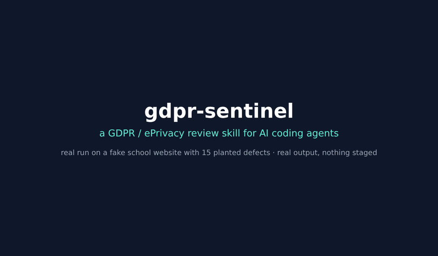
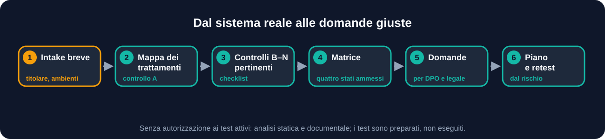
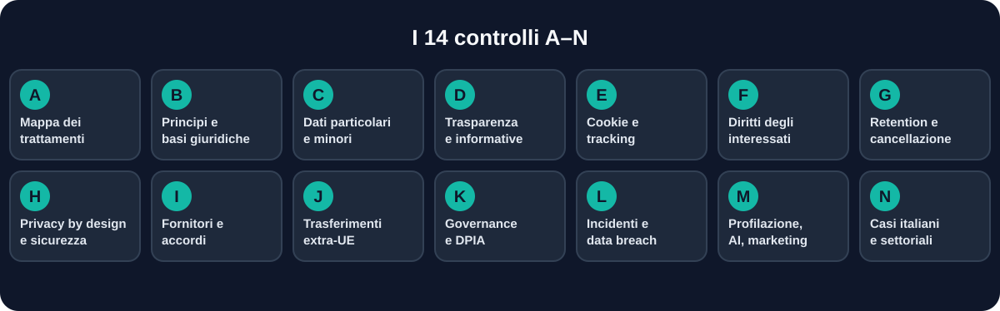
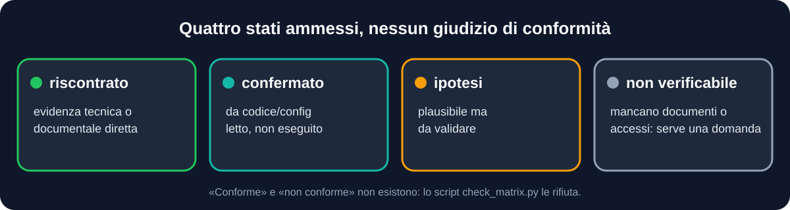
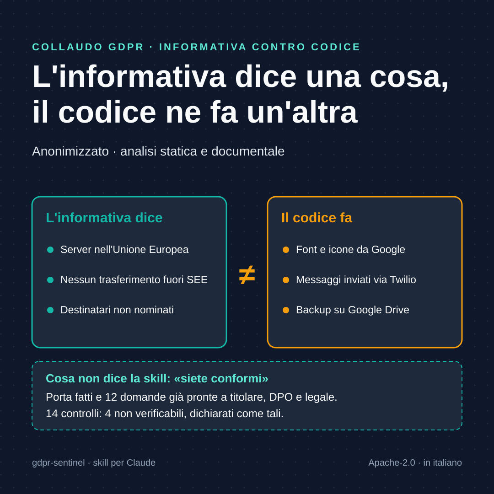
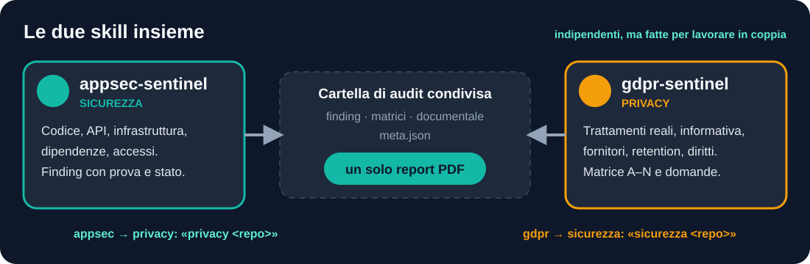

<div align="center">


<br>


[](https://dextsamu.github.io/gdpr-sentinel/)

## 🇬🇧 [Read in English →](README.md)

**«Siamo a posto col GDPR?» è la domanda sbagliata a cui rispondere di sì.**
Questa skill parte dal codice, dalla configurazione e dai documenti, e porta a titolare, DPO e legale **fatti** e **domande già scritte**, non verdetti. Nata per Claude, provata anche su Codex e Antigravity: vedi [`docs/ALTRI-AGENTI.md`](docs/ALTRI-AGENTI.md).

> 🌍 **English**: la pagina principale del repository è in inglese ([`README.md`](README.md)), con la [command card](docs/COMMAND-CARD.md). I comandi funzionano anche in inglese (`static`, `refute`, `close`…).
>
> 🗒️ **Subito operativo**: la [scheda comandi](docs/SCHEDA-COMANDI.md) in una pagina.
>
> 🤝 **Skill gemella**: per la parte di sicurezza (codice, API, infrastruttura, dipendenze) usa [`appsec-sentinel`](https://github.com/dextsamu/appsec-sentinel). Insieme producono un unico report PDF: vedi [Con appsec-sentinel](#con-appsec-sentinel).

<br>
<sub>Giro reale sul banco del sito scolastico: comandi e output veri, nulla di preparato. 15 difetti su 15, nessun falso allarme sulle 5 esche.</sub>

[Perché](#perché-esiste) · [Come funziona](#come-funziona) · [Controlli A–N](#i-controlli-an) · [Esempio](#dal-fatto-alla-domanda) · [Installazione](#installazione) · [Limiti](#cosa-non-fa) · [FAQ](#domande-frequenti)

</div>

---

## Perché esiste

La conformità non coincide con il banner dei cookie, con la cifratura o con una pagina privacy ben scritta: dipende da cosa il sistema **fa realmente** con i dati e da decisioni che spettano al titolare.

`gdpr-sentinel` confronta ciò che l'organizzazione dichiara con ciò che il sistema fa. Il risultato non è un parere, ma una base di fatti solida su cui un DPO o un legale possono decidere.

| | Principio | Cosa cambia per te |
|---|---|---|
| 🔍 | **Trattamento reale, non dichiarato** | Funzionalità, SDK e integrazioni assenti dall'informativa saltano fuori |
| ⚖️ | **Mai «conforme»** | Quattro stati ammessi, nessun giudizio finale |
| ❓ | **Ogni dubbio ha la sua domanda** | Un punto non verificabile diventa una domanda formulata, con il materiale necessario |
| 🧠 | **Giuridicamente prudente** | Non rende universali obblighi che dipendono da presupposti, scala o rischio; non inventa basi giuridiche al posto del titolare |

## Cosa ottieni

| Output | Contenuto |
|---|---|
| 🗂️ **Mappa dei trattamenti** | Una riga per trattamento: finalità, dati, interessati, destinatari, ruoli, retention; i campi non dimostrabili restano «non verificato» |
| 🧮 **Matrice GDPR/ePrivacy A–N** | Per ogni controllo: evidenza tecnica o documentale, stato, gap, rischio per gli interessati |
| 📨 **Domande aperte** | Per titolare, DPO, legale e fornitori, già pronte, con il materiale necessario |
| 🛠️ **Piano di intervento** | Priorità guidate dal rischio per gli interessati, non da scadenze arbitrarie, più il piano di retest |
| 🤖 **Prove e bozze automatiche** | Scansione di cookie e tracker prima del consenso, bozza del registro art. 30 e dei fornitori, evidenze di retention |
| 📄 **Report PDF** | Completo, versione breve per la direzione, in inglese, con confronto tra audit |
| 🧾 **Elenco dei limiti** | Che cosa non è stato verificato e perché |

I dati sono in Markdown e CSV, in una cartella riservata fuori dai repository pubblici.

## Come funziona

<div align="center">

</div>

1. **Intake breve**: titolare e ruoli noti, ambienti autorizzati, documenti disponibili (informativa, registro, DPA, DPIA), eventuale audit di sicurezza in corso.
2. **Mappa dei trattamenti** (controllo A) in `processing-map.csv`.
3. **Controlli B–N** pertinenti, con la checklist di `references/controls.md` e i trabocchetti giuridici da evitare.
4. **Matrice** in `gdpr-matrix.csv`, verificata da `check_matrix.py`.
5. **Domande** con `questions-template.md`.
6. **Piano di intervento** e di retest.

> [!IMPORTANT]
> Senza autorizzazione ai test attivi, la skill fa analisi statica e documentale e **prepara senza eseguire** i test del browser e delle richieste dei diritti.

## I controlli A–N

<div align="center">

</div>

<details>
<summary><b>Cosa si guarda in ciascun controllo</b> (tabella)</summary>

| | Controllo | Cosa si guarda |
|---|---|---|
| A | Mappa dei trattamenti e ruoli | Titolari, responsabili, contitolari, flussi, copie, log, backup, provider AI |
| B | Principi e basi giuridiche | Artt. 5 e 6; il consenso non è obbligatorio per ogni trattamento |
| C | Dati particolari, penali, minori | Art. 9 e art. 10; niente «biometrico» per ogni foto |
| D | Trasparenza | Informative (artt. 13/14) a confronto con interfacce, contratti e codice |
| E | Cookie e tracking | ePrivacy e linee guida del Garante; verifica in browser pulito prima e dopo la scelta |
| F | Diritti degli interessati | Accesso, rettifica, cancellazione, portabilità, opposizione; tempi e proroghe |
| G | Retention e cancellazione effettiva | Soft delete, repliche, cache, log, backup, dataset AI |
| H | Privacy by design e sicurezza | Artt. 25 e 32; collegamento ai finding di `appsec-sentinel` |
| I | Fornitori e accordi | DPA art. 28, art. 26, sub-responsabili, comportamento reale |
| J | Trasferimenti internazionali | Entità destinatarie, accessi remoti, meccanismo applicabile, stato attuale |
| K | Governance | Artt. 24, 27, 30, 35-39: responsabilità, registro, DPIA, DPO |
| L | Incidenti e data breach | Artt. 33-34: rilevazione, registro, notifiche; la decisione resta al titolare |
| M | Profilazione, AI e marketing | Art. 22, opposizione, flussi verso i provider, AI Act distinto |
| N | Casi italiani e settoriali | Lavoro, geolocalizzazione, sanitari, minori, ACN/NIS2 |
</details>

## Quattro stati, nessun giudizio

<div align="center">

</div>

Non esistono «conforme» e «non conforme». Lo script `check_matrix.py` rifiuta una matrice con stati non ammessi o con righe che affermano conformità.

## Dal fatto alla domanda

Una riga della matrice e la domanda che ne nasce, da un collaudo vero e anonimizzato.

<div align="center">

</div>

## Esempio di sessione

> Frasi pronte: [`docs/ESEMPI-DI-UTILIZZO.md`](docs/ESEMPI-DI-UTILIZZO.md). Un collaudo anonimizzato da un caso reale: [`examples/collaudo-statico/`](examples/collaudo-statico/README.md).



Il ritmo del lavoro, da un collaudo vero (gestionale web di proprietà di chi lo usa, solo analisi statica e documentale, anonimizzato):

> **Tu:** Verifica la parte privacy di questa applicazione. Solo analisi statica.
>
> **Agente:** Parto da ciò che l'applicazione fa davvero. Dal codice ricavo timbrature con GPS, assenze con certificati medici, notifiche push e WhatsApp, backup su un servizio cloud. Mi servono informativa, registro dei trattamenti, DPA e l'elenco dei fornitori; non avendoli, li tratto come «non verificabili» con la domanda già scritta.
>
> *(a fine lavoro)* Mappati 6 trattamenti. Matrice A–N: 14 controlli, 4 non verificabili perché dipendono da documenti o decisioni del titolare. Il punto concreto: l'informativa dice «server in UE, nessun trasferimento extra-SEE» e non nomina destinatari, mentre il codice carica font da Google, usa Twilio e fa backup su Drive. Dodici domande pronte, ciascuna con il destinatario: titolare, DPO, legale o fornitore.

Il caso completo, anonimizzato, è in [`examples/collaudo-statico/`](examples/collaudo-statico/README.md).

Nel risultato non compaiono né «conforme» né «non conforme»: le decisioni restano al titolare.

## Esempi di richiesta

```text
Verifica la parte privacy di questo sito: cookie, tracking e informativa.

Fai la mappa dei trattamenti del gestionale in questa cartella.

Siamo a posto col GDPR sul modulo iscrizioni? Dimmi cosa risulta e cosa va chiesto al DPO.

Controlla fornitori e trasferimenti extra-UE usati da questa app.

Prepara le domande per il legale sui tempi di conservazione dei log.
```

## Comandi

> 🗒️ Versione corta, una pagina: [**scheda comandi**](docs/SCHEDA-COMANDI.md).

Le skill non hanno sotto-comandi nativi: le parole qui sotto sono una **convenzione definita nelle istruzioni** (`SKILL.md`). Dove l'agente lo supporta (per esempio Claude Code) puoi anteporre il nome della skill con la barra; altrove scrivi la frase in chat. Nessun comando amplia il mandato.

| Comando | Cosa fa |
|---|---|
| `/gdpr-sentinel statica <repo>` | Valutazione A–N, solo analisi statica e documentale |
| `/gdpr-sentinel prepass <repo>` | Pre-passaggio deterministico: registro e fornitori in bozza, retention, indizi privacy nel codice (tracker, cookie, consenso, dati sanitari, minori, geolocalizzazione, log, diritti, marketing, informativa) |
| `/gdpr-sentinel doppio <repo>` | Due giri indipendenti e la loro unione: per i casi in cui il risultato conta |
| `/gdpr-sentinel informativa <repo>` | Confronto tra informativa e codice (controllo D) |
| `/gdpr-sentinel cookie <repo> [url…]` | Cookie e tracking (controllo E); con URL locale o autorizzato, scansione di cookie, storage e terze parti **prima del consenso** |
| `/gdpr-sentinel retention <repo>` | Conservazione e cancellazione, backup compresi (controllo G), con evidenze nel codice e confronto con i tempi dichiarati |
| `/gdpr-sentinel fornitori <repo>` | Fornitori e trasferimenti (controlli I e J), con le domande per DPA |
| `/gdpr-sentinel documentale <repo>` | Audit documentale privacy (informativa, registro, DPIA, DPA, procedure) e report PDF aziendale |
| `/gdpr-sentinel bozza-registro <repo>` | Bozza del registro dei trattamenti (art. 30) e dei fornitori, ricavata dal codice |
| `/gdpr-sentinel chiudi [cartella]` | Controllo di consegna in un solo passo: zero «falliti» prima di dare la valutazione |
| `/gdpr-sentinel smentita [cartella]` | Un verificatore diverso dall'autore prova a confutare ogni gap riscontrato o confermato |
| `/gdpr-sentinel redazione [cartella]` | Controlla segreti e dati personali prima di consegnare |
| `/gdpr-sentinel confronta <vecchio> <nuovo>` | Differenze tra due audit |
| `/gdpr-sentinel sicurezza <repo>` | Passa ad `appsec-sentinel` per i finding di sicurezza che incidono sui dati (art. 32) |
| `/gdpr-sentinel pdf [cartella]` | Genera il report PDF dai file di lavoro (opzioni: `--sintetico`, `--lang en`, `--previous`, `--nis2`) |
| `/gdpr-sentinel domande [cartella]` | Domande aperte per titolare, DPO, legale, fornitori |
| `/gdpr-sentinel report [cartella]` | Controlla la matrice e consegna matrice, domande e piano |

Script da riga di comando:

```bash
python3 scripts/init_gdpr.py <cartella>                                      # crea la cartella di lavoro
pip install reportlab                                                         # una volta sola
python3 scripts/build_report_pdf.py <cartella>                               # report PDF in formato aziendale
python3 scripts/check_matrix.py <gdpr-matrix.csv> [--map processing-map.csv] # controlla la matrice
```

Esempi completi: [`docs/ESEMPI-DI-UTILIZZO.md`](docs/ESEMPI-DI-UTILIZZO.md).

## Strumenti automatici

Script in `scripts/` che preparano prove e bozze senza stabilire la conformità. Flusso e limiti in [`references/automation.md`](references/automation.md).

| Script | Cosa fa | Limite dichiarato |
|---|---|---|
| `cookie_scan.py` | Browser pulito, nessun clic: registra cookie (mai i valori), storage e domini di terzi | URL locali o con conferma scritta del titolare; classificazione indicativa |
| `draft_ropa.py` | Bozza di processing map e fornitori da schema, dipendenze e URL | Tutto «ipotesi da validare»: ruoli, basi giuridiche e paesi li conferma il titolare |
| `draft_dpia.py` | Bozza di scheda DPIA (art. 35) dalla mappa dei trattamenti, con indicatori di necessità | Non è una DPIA e non decide se serve: lo stabilisce il titolare con il DPO |
| `retention_check.py` | Job pianificati, cancellazioni con soglia, modelli senza cancellazione evidente | L'assenza di evidenza non è una violazione |
| `canonicalize.py` | Riporta ai valori canonici italiani stati e severità scritti in inglese | Tocca solo valori enumerati, mai il testo libero |
| `check_delivery.py` | Un solo controllo prima della consegna: matrice, smentite, redazione (anche i valori dei segreti), parole vietate | Meccanico: non prova che la valutazione sia giusta |
| `redact_check.py`, `compare_audits.py` | Controllo di redazione; confronto tra audit | Non stampa mai i valori; «risolto» non è «verificato» |

Collaudo: `python3 tests/run_checks.py`.

## Report PDF aziendale

Il comando `documentale` esamina i documenti privacy (informativa, registro, DPIA, DPA, procedure) e li **confronta con il trattamento reale**; `scripts/build_report_pdf.py` assembla un PDF A4 con copertina, sintesi, matrice A–N, mappa dei trattamenti, audit documentale, domande e limiti. Nessun «conforme» o «non conforme».

Opzioni: `--sintetico` per una versione breve alla direzione (copertina, sintesi, quadro, piano), `--lang en` per titoli ed etichette in inglese (il contenuto resta nella lingua dei file), `--previous <findings.json>` per aggiungere il confronto con un audit precedente e `--nis2` per una mappatura **indicativa** sulle misure dell'art. 21 della NIS2, che non stabilisce se il soggetto rientra nell'ambito né valuta la conformità. Il tema è teal per la sicurezza e ambra per la privacy.

Un esempio anonimizzato, da un caso reale: [`examples/collaudo-statico/report-esempio.pdf`](examples/collaudo-statico/report-esempio.pdf). Metodo: [`references/documentary-audit.md`](references/documentary-audit.md).

## Installazione

**Claude.ai**: scarica `gdpr-sentinel.skill` dalle [Release](https://github.com/dextsamu/gdpr-sentinel/releases) e caricalo da *Impostazioni → Capacità → Skill*.

**Claude Code**, come plugin (si aggiorna da solo alle nuove versioni):
```text
/plugin marketplace add dextsamu/gdpr-sentinel
/plugin install gdpr-sentinel@gdpr-sentinel
```
Dallo stesso marketplace si installa anche la skill gemella: `/plugin install appsec-sentinel@gdpr-sentinel`. In alternativa, come cartella di skill:
```bash
git clone https://github.com/dextsamu/gdpr-sentinel ~/.claude/skills/gdpr-sentinel
```
oppure, per un solo progetto, in `<progetto>/.claude/skills/gdpr-sentinel/`.

**Altri agenti** (Codex, Antigravity): vedi [`docs/ALTRI-AGENTI.md`](docs/ALTRI-AGENTI.md) per i percorsi di installazione e per cosa è stato provato.

## Struttura

```
SKILL.md                      metodo, stati, controlli A–N in sintesi
references/
  controls.md                 checklist dettagliata con gli errori da evitare
  sources.md                  fonti ufficiali e data di verifica
  automation.md               flusso e limiti degli script automatici
assets/
  processing-map.csv  gdpr-matrix.csv  questions-template.md
scripts/
  check_matrix.py             controlla la matrice (solo libreria standard di Python)
  cookie_scan.py  draft_ropa.py  draft_dpia.py  retention_check.py  redact_check.py
  compare_audits.py  build_report_pdf.py  init_gdpr.py
tests/                        app di prova con difetti noti e run_checks.py
```

## Con `appsec-sentinel`



`gdpr-sentinel` guarda la **privacy**; la sua gemella [`appsec-sentinel`](https://github.com/dextsamu/appsec-sentinel) guarda la **sicurezza** (codice, API, infrastruttura, dipendenze). Funzionano anche da sole, ma insieme si completano:

- **Dalla privacy alla sicurezza**: il controllo H (artt. 25 e 32) si appoggia ai finding di `appsec-sentinel`; `/gdpr-sentinel sicurezza <repo>` passa il lavoro alla gemella.
- **Dalla sicurezza alla privacy**: se hai già un audit di sicurezza, `gdpr-sentinel` usa la stessa cartella e collega i finding che incidono sui dati personali, senza rifarli.
- **Un solo report**: se le due skill scrivono nella stessa cartella, `scripts/build_report_pdf.py` produce un unico PDF con finding, audit documentale, matrice privacy e domande.

## Cosa NON fa

- Non è un parere legale e non sostituisce DPO, avvocato o organismo di certificazione.
- Non produce DPIA, registro dei trattamenti o gestione dei diritti: valuta se il sistema reale li rende possibili e coerenti.
- Non decide basi giuridiche, notifiche di violazione o trasferimenti al posto del titolare.
- Non cita da memoria termini, decisioni di adeguatezza o adesioni al DPF: vanno verificati sulle fonti ufficiali al momento dell'uso.
- Non porta dati personali reali nei report: usa identificatori sintetici e redazione.

## Domande frequenti

<details>
<summary><b>La bozza del registro dei trattamenti è il registro dell'art. 30?</b></summary>

No: è una bozza ricavata dal codice, tutta in «ipotesi da validare». Il codice mostra cosa il software può trattare e a chi può inviare dati, non chi è titolare o responsabile, né basi giuridiche, paesi e tempi di conservazione. Quelle colonne le conferma il titolare.
</details>

<details>
<summary><b>Posso scansionare i cookie del sito di un cliente?</b></summary>

Solo con la conferma scritta del titolare: `cookie_scan.py` rifiuta gli URL non locali senza `--autorizzato`. Non clicca il banner, non accede, non salva i valori dei cookie. La classificazione dei domini è indicativa, non un parere sulla necessità del consenso.
</details>

<details>
<summary><b>Mi dice se sono conforme?</b></summary>

No, per scelta. Ti dice cosa risulta dal sistema, cosa non si può verificare e quali decisioni spettano al titolare.
</details>

<details>
<summary><b>Serve l'accesso al sistema in produzione?</b></summary>

No. Il lavoro parte da codice, configurazione e documenti. I test attivi (browser pulito, richieste di diritti) si fanno solo su ambienti autorizzati, con account sintetici e nessun messaggio reale.
</details>

<details>
<summary><b>Vale per la pubblica amministrazione?</b></summary>

Sì: è pensata anche per PA, associazioni e piccole organizzazioni. Il controllo N considera i casi italiani e settoriali, compresi ACN e NIS2.
</details>

<details>
<summary><b>Chi risponde alle domande che genera?</b></summary>

Titolare, DPO, legale o fornitori, a seconda del punto: la skill indica il destinatario di ciascuna.
</details>

## Stato del progetto

Cosa viene dopo, in ordine e con il numero che ogni voce deve migliorare: [ROADMAP.md](ROADMAP.md).

Versione 1.5.0. Cosa è già verificato e cosa no, in modo esplicito:

- Gli script e i template sono verificati automaticamente a ogni modifica (GitHub Actions); `tests/run_checks.py` prova gli script contro un'app finta con difetti noti. Per ora la CI su GitHub dipende dal limite di spesa dell'account, quindi il collaudo è stato eseguito in locale.
- **Primo collaudo su un caso reale** (30/10/2026): applicazione web di proprietà dell'autore, sola analisi statica e documentale. Ha fatto emergere uno scostamento fra informativa e codice e ha fatto correggere le istruzioni (vedi CHANGELOG). Resta da collaudare: `cookie_scan.py` su un sito reale autorizzato (provato solo su una pagina locale), la verifica dei diritti su istanza autorizzata, e la bozza dell'art. 30 su progetti più piccoli: su un'app grande produce molte righe da raggruppare a mano. Dopo (31/10/2026): banco privacy `tests/bench-app` (15/15 difetti noti in due giri) e secondo banco `tests/bench-pa`, sito di una scuola in PHP (15/15 in due giri, 0 falsi allarmi) e quattro giri reali sullo stesso gestionale: due giri concordano sul 63% delle cause (dopo la regola «un gap = una causa»; prima 44–46%), quindi su un'app grande usa `doppio`. Con le tre matrici (per entità, informativa, ruoli e accessi; 1.5.0) due giri danno lo stesso giudizio sul 90–93%, 83–88% e 86–92% delle righe da chiudere; sull'insieme dei gap l'accordo resta 60–69%. Segnala ciò che si rompe o confonde con una issue.
- **Altri agenti.** Provata una volta su Codex e su Antigravity (Windows, modalità `rapido`, app finta, solo analisi statica): le regole sono state rispettate e le lacune emerse sono state corrette nella 1.1.0. Non è una garanzia di compatibilità: vedi [`docs/ALTRI-AGENTI.md`](docs/ALTRI-AGENTI.md).
- Le fonti su normativa e linee guida sono state controllate il 29/10/2026. Termini, decisioni di adeguatezza e adesioni al DPF cambiano: vanno riverificati ogni volta che servono.

## Uso responsabile

> [!WARNING]
> Strumento di supporto, fornito «così com'è», **senza garanzie**; non è consulenza legale. Se la valutazione tocca dati personali reali, definisci prima ruoli e riservatezza (per esempio la nomina a responsabile del trattamento, art. 28 GDPR) e usala con l'autorizzazione del titolare. L'utente risponde dell'uso e dei risultati, secondo le sezioni 7 e 8 della licenza.

## Licenza e crediti

Copyright 2026 Samuele Cucurnia e Pietro Previtali, licenza [Apache-2.0](LICENSE) (vedi anche [NOTICE](NOTICE)).

La skill nasce da un prompt di assessment fornito da **Pietro Previtali** ed è stata adattata e strutturata da **Samuele Cucurnia** con il supporto di Claude (Anthropic).

**Nessuna affiliazione**: il progetto non è affiliato né approvato da Garante per la protezione dei dati personali, EDPB, Commissione europea, OWASP, NIST, ACN, AgID, Anthropic o altri enti citati. I marchi appartengono ai rispettivi titolari. Le fonti di terzi sono collegate o riassunte, non riprodotte: vedi [THIRD_PARTY.md](THIRD_PARTY.md).

## Contribuire e segnalare

- Correzioni alle fonti e ai checklist, nuovi template e bug nello script sono benvenuti: [CONTRIBUTING.md](CONTRIBUTING.md).
- Problemi di sicurezza o istruzioni che potrebbero indurre a conclusioni giuridiche indebite: [SECURITY.md](SECURITY.md).
- Cronologia delle versioni: [CHANGELOG.md](CHANGELOG.md).
