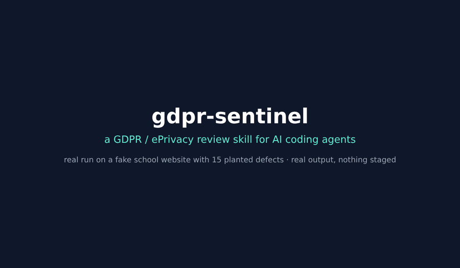
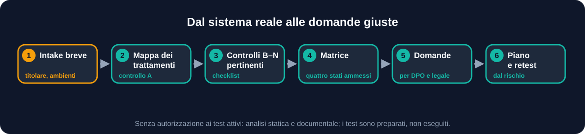
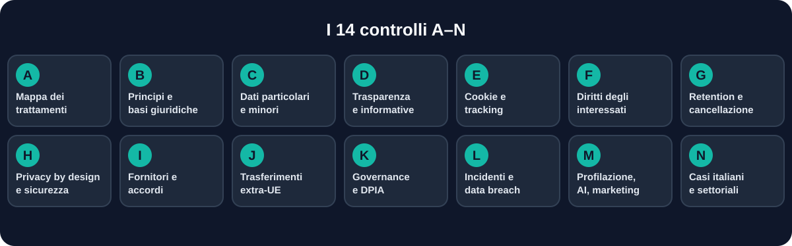
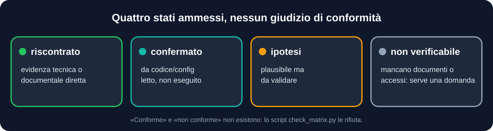
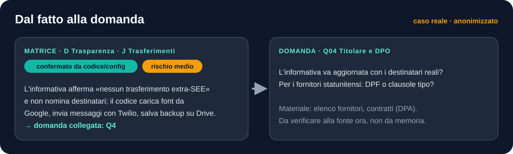
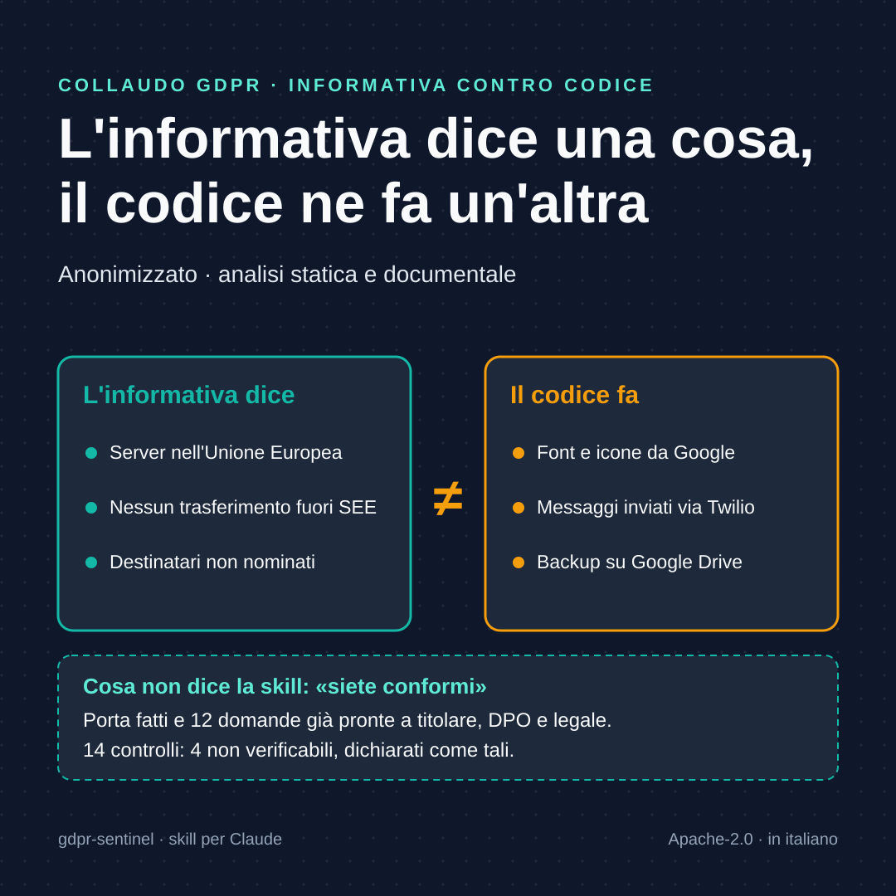
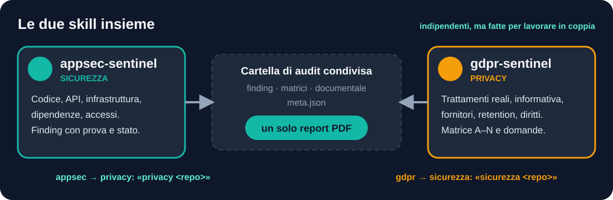

<div align="center">


<br>


[](https://dextsamu.github.io/gdpr-sentinel/index.en.html)

## 🇮🇹 [Leggi in italiano →](README.it.md)

**"Are we GDPR compliant?" is the wrong question to answer yes to.**
This skill starts from the code, the configuration and the documents, and brings the controller, the DPO and the lawyer **facts** and **ready-written questions**, not verdicts. Built for Claude, also tested on Codex and Antigravity: see [`docs/ALTRI-AGENTI.md`](docs/ALTRI-AGENTI.md) (in Italian).

> 🗒️ **Get started**: the one-page [command card](docs/COMMAND-CARD.md). Every command works in English or Italian (`static`/`statica`, `refute`/`smentita`, `close`/`chiudi`…).
>
> 🤝 **Sister skill**: for security (code, APIs, infrastructure, dependencies) use [`appsec-sentinel`](https://github.com/dextsamu/appsec-sentinel). Together they produce a single PDF report: see [With appsec-sentinel](#with-appsec-sentinel).

<br>
<sub>Real run on the school-website bench: real commands and output, nothing staged. 15 of 15 planted defects, no false alarm on the 5 decoys.</sub>

[Why](#why-it-exists) · [How it works](#how-it-works) · [Controls A–N](#controls-an) · [Example](#from-fact-to-question) · [Installation](#installation) · [Limits](#what-it-does-not-do) · [FAQ](#faq)

</div>

---

## Why it exists

Compliance is not the cookie banner, encryption or a well-written privacy page: it depends on what the system **actually does** with the data and on decisions that belong to the controller.

`gdpr-sentinel` compares what the organization declares with what the system does. The result is not an opinion but a solid base of facts a DPO or a lawyer can decide on.

| | Principle | What changes for you |
|---|---|---|
| 🔍 | **Real processing, not declared processing** | Features, SDKs and integrations missing from the privacy notice come to light |
| ⚖️ | **Never "compliant"** | Four allowed states, no final verdict |
| ❓ | **Every doubt gets its question** | A point that cannot be verified becomes a written question, with the material needed |
| 🧠 | **Legally careful** | It does not make universal obligations that depend on conditions, scale or risk; it does not invent legal bases on the controller's behalf |

## What you get

| Output | Content |
|---|---|
| 🗂️ **Processing map** | One row per processing activity: purpose, data, data subjects, recipients, roles, retention; fields that cannot be proven stay "not verified" |
| 🧮 **GDPR/ePrivacy matrix A–N** | For each control: technical or documentary evidence, state, gap, risk to data subjects |
| 🧩 **Fixed matrices** | Per data entity (deletion, export, erasure, tenant isolation), privacy notice item by item, and who can see what for each role |
| 📨 **Open questions** | For the controller, DPO, lawyer and suppliers, ready to send, with the material needed |
| 🛠️ **Action plan** | Priorities driven by the risk to data subjects, not by arbitrary deadlines, plus the retest plan |
| 🤖 **Automated evidence and drafts** | Cookie and tracker scan before consent, draft record of processing (Art. 30) and supplier list, retention evidence |
| 📄 **PDF report** | Full, short executive version, English labels, comparison between audits |
| 🧾 **List of limits** | What was not verified and why |

Data is stored as Markdown and CSV in a confidential folder outside public repositories.

## How it works

<div align="center">

</div>

1. **Short intake**: controller and known roles, authorized environments, available documents (privacy notice, record of processing, DPAs, DPIA), any security audit in progress.
2. **Processing map** (control A) in `processing-map.csv`.
3. The relevant **controls B–N**, with the checklist in `references/controls.md` and the legal pitfalls to avoid.
4. **Matrix** in `gdpr-matrix.csv`, checked by `check_matrix.py`.
5. **Questions** with `questions-template.md`.
6. **Action plan** and retest plan.

> [!IMPORTANT]
> Without authorization for active tests, the skill does static and documentary analysis and **prepares without running** the browser tests and the data-subject requests.

## Controls A–N

<div align="center">

</div>

<details>
<summary><b>What each control looks at</b> (table)</summary>

| | Control | What is checked |
|---|---|---|
| A | Processing map and roles | Controllers, processors, joint controllers, flows, copies, logs, backups, AI providers |
| B | Principles and legal bases | Arts. 5 and 6; consent is not required for every processing activity |
| C | Special categories, criminal data, minors | Art. 9 and Art. 10; not every photo is "biometric" |
| D | Transparency | Privacy notices (Arts. 13/14) compared with interfaces, contracts and code |
| E | Cookies and tracking | ePrivacy and the Italian Garante's guidelines; checked in a clean browser before and after the choice |
| F | Data-subject rights | Access, rectification, erasure, portability, objection; deadlines and extensions |
| G | Retention and actual deletion | Soft delete, replicas, caches, logs, backups, AI datasets |
| H | Privacy by design and security | Arts. 25 and 32; linked to `appsec-sentinel` findings |
| I | Suppliers and agreements | Art. 28 DPAs, Art. 26, sub-processors, actual behaviour |
| J | International transfers | Receiving entities, remote access, applicable mechanism, current status |
| K | Governance | Arts. 24, 27, 30, 35-39: accountability, record of processing, DPIA, DPO |
| L | Incidents and data breaches | Arts. 33-34: detection, register, notifications; the decision stays with the controller |
| M | Profiling, AI and marketing | Art. 22, objection, flows to providers, the AI Act kept separate |
| N | Italian and sector-specific cases | Employment, geolocation, health, minors, ACN/NIS2 |
</details>

## Four states, no verdict

<div align="center">

</div>

There is no "compliant" or "non-compliant". The states are found (`riscontrato`), confirmed from code or configuration (`confermato da codice/config`), hypothesis to validate (`ipotesi da validare`) and not verifiable (`non verificabile`). The script `check_matrix.py` rejects a matrix with states that are not allowed or with rows that claim compliance.

## From fact to question

One matrix row and the question it leads to, from a real anonymized test run.

<div align="center">

</div>

## Example session

> Ready-made phrases: [`docs/ESEMPI-DI-UTILIZZO.md`](docs/ESEMPI-DI-UTILIZZO.md) (in Italian). An anonymized test run from a real case: [`examples/collaudo-statico/`](examples/collaudo-statico/README.md).



The rhythm of the work, from a real test run (a web management app owned by the person using the skill, static and documentary analysis only, anonymized):

> **You:** Check the privacy side of this application. Static analysis only.
>
> **Agent:** I'll start from what the application really does. From the code I can see time clocking with GPS, absences with medical certificates, push and WhatsApp notifications, backups to a cloud service. I need the privacy notice, the record of processing, the DPAs and the supplier list; since I don't have them, I treat them as "not verifiable", with the question already written.
>
> *(at the end)* 6 processing activities mapped. A–N matrix: 14 controls, 4 not verifiable because they depend on documents or decisions of the controller. The concrete point: the privacy notice says "servers in the EU, no transfers outside the EEA" and names no recipients, while the code loads fonts from Google, uses Twilio and backs up to Drive. Twelve questions ready, each with its recipient: controller, DPO, lawyer or supplier.

The full case, anonymized, is in [`examples/collaudo-statico/`](examples/collaudo-statico/README.md).

Neither "compliant" nor "non-compliant" appears in the result: the decisions stay with the controller.

## Example requests

```text
Check the privacy side of this website: cookies, tracking and privacy notice.

Build the processing map of the management app in this folder.

Are we GDPR compliant on the registration form? Tell me what the code shows and what to ask the DPO.

Check the suppliers and transfers outside the EU used by this app.

Prepare the questions for the lawyer on log retention periods.
```

## Commands

> 🗒️ Short version, one page: [**command card**](docs/COMMAND-CARD.md).

Skills have no native sub-commands: the words below are a **convention defined in the instructions** (`SKILL.md`). Where the agent supports it (for example Claude Code) you can prefix the skill name with a slash; elsewhere, write the phrase in chat. Every command also works with its Italian word. No command widens the mandate.

| Command | What it does |
|---|---|
| `/gdpr-sentinel static <repo>` | A–N assessment, static and documentary analysis only |
| `/gdpr-sentinel prepass <repo>` | Deterministic pre-pass: draft record and suppliers, retention, privacy hints in the code (trackers, cookies, consent, health data, minors, geolocation, logs, rights, marketing, privacy notice), and the three fixed matrices |
| `/gdpr-sentinel double <repo>` | Two independent runs and their merge: for when the result matters |
| `/gdpr-sentinel notice <repo>` | Privacy notice versus code (control D) |
| `/gdpr-sentinel cookie <repo> [url…]` | Cookies and tracking (control E); with a local or authorized URL, scans cookies, storage and third parties **before consent** |
| `/gdpr-sentinel retention <repo>` | Retention and deletion, backups included (control G), with evidence in the code compared to the declared periods |
| `/gdpr-sentinel suppliers <repo>` | Suppliers and transfers (controls I and J), with the questions for the DPAs |
| `/gdpr-sentinel documentary <repo>` | Privacy documentary audit (privacy notice, record, DPIA, DPAs, procedures) and a corporate PDF report |
| `/gdpr-sentinel draft-register <repo>` | Draft record of processing (Art. 30) and supplier list, derived from the code |
| `/gdpr-sentinel close [folder]` | Delivery check in one step: zero "FAIL" before delivering the assessment |
| `/gdpr-sentinel refute [folder]` | A verifier other than the author tries to refute every found or confirmed gap |
| `/gdpr-sentinel redact [folder]` | Checks for secrets and personal data before delivery |
| `/gdpr-sentinel compare <old> <new>` | Differences between two audits |
| `/gdpr-sentinel security <repo>` | Hands over to `appsec-sentinel` for security findings that affect data (Art. 32) |
| `/gdpr-sentinel pdf [folder]` | Builds the PDF report from the working files (options: `--sintetico`, `--lang en`, `--previous`, `--nis2`) |
| `/gdpr-sentinel questions [folder]` | Open questions for the controller, DPO, lawyer, suppliers |
| `/gdpr-sentinel report [folder]` | Checks the matrix and delivers matrix, questions and plan |

Command-line scripts:

```bash
python3 scripts/init_gdpr.py <folder>                                        # creates the working folder
pip install reportlab                                                         # once
python3 scripts/build_report_pdf.py <folder>                                 # corporate PDF report
python3 scripts/check_matrix.py <gdpr-matrix.csv> [--map processing-map.csv] # checks the matrix
```

Full examples: [`docs/ESEMPI-DI-UTILIZZO.md`](docs/ESEMPI-DI-UTILIZZO.md) (in Italian).

## Automated tools

Scripts in `scripts/` that prepare evidence and drafts without deciding compliance. Flow and limits in [`references/automation.md`](references/automation.md).

| Script | What it does | Stated limit |
|---|---|---|
| `cookie_scan.py` | Clean browser, no clicks: records cookies (never their values), storage and third-party domains | Local URLs or with the controller's written confirmation; indicative classification |
| `draft_ropa.py` | Draft processing map and suppliers from schema, dependencies and URLs | All "hypothesis to validate": roles, legal bases and countries are confirmed by the controller |
| `draft_dpia.py` | Draft DPIA sheet (Art. 35) from the processing map, with need indicators | Not a DPIA and it does not decide whether one is needed: the controller decides with the DPO |
| `retention_check.py` | Scheduled jobs, threshold-based deletions, models with no evident deletion | Absence of evidence is not a violation |
| `entity_matrix.py`, `notice_matrix.py`, `access_matrix.py` | Fixed rows per data entity, per privacy-notice item and per role, so two runs answer the same questions | The first answer is mechanical; the agent closes every open row |
| `canonicalize.py` | Converts states and severities written in English to the canonical Italian values | Touches only enumerated values, never free text |
| `check_delivery.py` | One check before delivery: matrix, refutations, redaction (including secret values), forbidden words, open matrix rows | Mechanical: it does not prove the assessment is right |
| `redact_check.py`, `compare_audits.py` | Redaction check; comparison between audits | Never prints values; "resolved" is not "verified" |

Tests: `python3 tests/run_checks.py`.

## Corporate PDF report

The `documentary` command examines the privacy documents (privacy notice, record of processing, DPIA, DPAs, procedures) and **compares them with the real processing**; `scripts/build_report_pdf.py` assembles an A4 PDF with cover, summary, A–N matrix, processing map, documentary audit, questions and limits. No "compliant" or "non-compliant".

Options: `--sintetico` for a short version for management (cover, summary, overview, plan), `--lang en` for English titles and labels (the content stays in the language of the files), `--previous <findings.json>` to add a comparison with a previous audit, and `--nis2` for an **indicative** mapping onto the measures of NIS2 Article 21, which neither decides whether the entity is in scope nor assesses compliance. The theme is teal for security and amber for privacy.

An anonymized example from a real case: [`examples/collaudo-statico/report-esempio.pdf`](examples/collaudo-statico/report-esempio.pdf). Method: [`references/documentary-audit.md`](references/documentary-audit.md).

## Installation

**Claude.ai**: download `gdpr-sentinel.skill` from the [Releases](https://github.com/dextsamu/gdpr-sentinel/releases) and upload it under *Settings → Capabilities → Skills*.

**Claude Code**, as a plugin (updates itself to new versions):
```text
/plugin marketplace add dextsamu/gdpr-sentinel
/plugin install gdpr-sentinel@gdpr-sentinel
```
The sister skill installs from the same marketplace: `/plugin install appsec-sentinel@gdpr-sentinel`. Alternatively, as a skill folder:
```bash
git clone https://github.com/dextsamu/gdpr-sentinel ~/.claude/skills/gdpr-sentinel
```
or, for a single project, in `<project>/.claude/skills/gdpr-sentinel/`.

**Other agents** (Codex, Antigravity): see [`docs/ALTRI-AGENTI.md`](docs/ALTRI-AGENTI.md) (in Italian) for the install paths and what was tested.

## Structure

```
SKILL.md                      method, states, controls A–N in brief
references/
  controls.md                 detailed checklist with the mistakes to avoid
  sources.md                  official sources and date checked
  automation.md               flow and limits of the automated scripts
assets/
  processing-map.csv  gdpr-matrix.csv  questions-template.md
scripts/
  check_matrix.py             checks the matrix (Python standard library only)
  cookie_scan.py  draft_ropa.py  draft_dpia.py  retention_check.py  redact_check.py
  entity_matrix.py  notice_matrix.py  access_matrix.py
  compare_audits.py  build_report_pdf.py  init_gdpr.py
tests/                        test apps with known flaws and run_checks.py
```

The skill's own instructions, references and templates are written in Italian (the authors work with Italian public administrations and non-profits); the agent applies them and answers in your language. Machine-readable files keep canonical Italian field names and enum values because the scripts check them.

## With `appsec-sentinel`



`gdpr-sentinel` looks at **privacy**; its sister skill [`appsec-sentinel`](https://github.com/dextsamu/appsec-sentinel) looks at **security** (code, APIs, infrastructure, dependencies). They work on their own, but together they complement each other:

- **From privacy to security**: control H (Arts. 25 and 32) relies on `appsec-sentinel` findings; `/gdpr-sentinel security <repo>` hands the work to the sister skill.
- **From security to privacy**: if you already have a security audit, `gdpr-sentinel` uses the same folder and links the findings that affect personal data, without redoing them.
- **One report**: if both skills write to the same folder, `scripts/build_report_pdf.py` produces a single PDF with findings, documentary audit, privacy matrix and questions.

## What it does not do

- It is not legal advice and does not replace a DPO, a lawyer or a certification body.
- It does not produce a DPIA, a record of processing or rights handling: it assesses whether the real system makes them possible and consistent.
- It does not decide legal bases, breach notifications or transfers on the controller's behalf.
- It does not quote deadlines, adequacy decisions or Data Privacy Framework certifications from memory: they must be checked against official sources at the time of use.
- It does not put real personal data in reports: it uses synthetic identifiers and redaction.

## FAQ

<details>
<summary><b>Is the draft record of processing the Art. 30 record?</b></summary>

No: it is a draft derived from the code, all "hypothesis to validate". The code shows what the software can process and where it can send data, not who is controller or processor, nor legal bases, countries or retention periods. Those columns are confirmed by the controller.
</details>

<details>
<summary><b>Can I scan the cookies of a client's website?</b></summary>

Only with the controller's written confirmation: `cookie_scan.py` refuses non-local URLs without `--autorizzato`. It does not click the banner, does not log in, does not save cookie values. The domain classification is indicative, not an opinion on whether consent is required.
</details>

<details>
<summary><b>Will it tell me whether I'm compliant?</b></summary>

No, by design. It tells you what the system shows, what cannot be verified and which decisions belong to the controller.
</details>

<details>
<summary><b>Does it need access to the production system?</b></summary>

No. The work starts from code, configuration and documents. Active tests (clean browser, rights requests) are done only on authorized environments, with synthetic accounts and no real messages.
</details>

<details>
<summary><b>Is it suitable for public administrations?</b></summary>

Yes: it is designed for public bodies, associations and small organizations too. Control N covers Italian and sector-specific cases, including ACN and NIS2.
</details>

<details>
<summary><b>Who answers the questions it generates?</b></summary>

The controller, the DPO, the lawyer or the suppliers, depending on the point: the skill names the recipient of each one.
</details>

## Project status

What comes next, in order and with the number each item must improve: [ROADMAP.md](ROADMAP.md) (in Italian).

Version 1.5.0. What has been verified and what has not, explicitly:

- Scripts and templates are checked automatically on every change (GitHub Actions); `tests/run_checks.py` tests the scripts against a fake app with known flaws.
- **First test on a real case** (30/10/2026): a web application owned by the author, static and documentary analysis only. It surfaced a gap between privacy notice and code and led to fixes in the instructions (see CHANGELOG). Still to be tested: `cookie_scan.py` on a real authorized website (only tested on a local page), rights checks on an authorized instance, and the Art. 30 draft on smaller projects: on a large app it produces many rows to group by hand. After that (31/10/2026): the privacy bench `tests/bench-app` (15/15 known defects in two runs), a second bench `tests/bench-pa`, a school website in PHP (15/15 in two runs, 0 false alarms), and repeated real runs on the same management app. With the three fixed matrices (per entity, privacy notice, roles and access; 1.5.0), two runs give the same answer on 90–93%, 83–88% and 86–92% of the rows to close; on the whole set of gaps agreement stays at 60–69%, so on a large app use `double`. Please report anything that breaks or confuses you with an issue.
- **Other agents.** Tested on Codex and Antigravity (Windows, static analysis only): the rules were followed and the gaps that came up were fixed. This is not a compatibility guarantee: see [`docs/ALTRI-AGENTI.md`](docs/ALTRI-AGENTI.md).
- Sources on law and guidelines were checked on 29/10/2026. Deadlines, adequacy decisions and DPF certifications change: check them again every time you need them.

## Responsible use

> [!WARNING]
> A support tool, provided "as is", **without warranty**; it is not legal advice. If the assessment touches real personal data, first define roles and confidentiality (for example the appointment as processor, GDPR Art. 28) and use it with the controller's authorization. The user is responsible for its use and results, under sections 7 and 8 of the license.

## License and credits

Copyright 2026 Samuele Cucurnia and Pietro Previtali, licensed under [Apache-2.0](LICENSE) (see also [NOTICE](NOTICE)).

The skill comes from an assessment prompt provided by **Pietro Previtali** and was adapted and structured by **Samuele Cucurnia** with the support of Claude (Anthropic).

**No affiliation**: the project is not affiliated with or endorsed by the Italian Data Protection Authority (Garante), the EDPB, the European Commission, OWASP, NIST, ACN, AgID, Anthropic or the other bodies mentioned. Trademarks belong to their owners. Third-party sources are linked or summarized, not reproduced: see [THIRD_PARTY.md](THIRD_PARTY.md).

## Contributing and reporting

- Fixes to sources and checklists, new templates and script bugs are welcome: [CONTRIBUTING.md](CONTRIBUTING.md).
- Security problems, or instructions that could lead to unwarranted legal conclusions: [SECURITY.md](SECURITY.md).
- Version history: [CHANGELOG.md](CHANGELOG.md) (in Italian).
