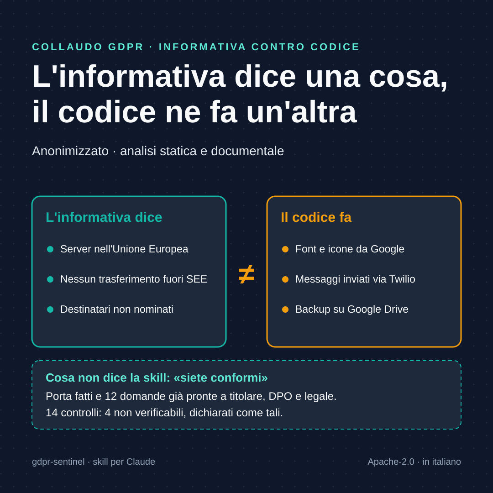

# Esempio: collaudo GDPR statico di un'applicazione web (anonimizzato)
Caso ricavato da un collaudo reale su un gestionale web di proprietà dell'autore: solo analisi statica e documentale; non è un parere legale e non esprime giudizi di conformità. Nomi e identificatori sostituiti.

Scheda quadrata pronta per i social: [`docs/img/caso-reale.png`](../../docs/img/caso-reale.png).

Il report PDF d'esempio, generato da `scripts/build_report_pdf.py`: [`report-esempio.pdf`](report-esempio.pdf).

## Esito in breve
Matrice A–N validata: 14 controlli, 4 non verificabili, 0 errori. Il punto concreto è uno scostamento fra informativa e codice (controlli D, J), confermato da configurazione:

- L'informativa (`pagina privacy`) dice che i dati sono su server nell'UE e che non ci sono trasferimenti extra-SEE e non nomina destinatari.
- Il codice carica font e icone da Google su ogni pagina, anche prima del login e del consenso (`layout principale`, `foglio di stile globale`), invia messaggi tramite Twilio (`modulo di invio messaggi`) e la guida ai backup usa Google Drive.
- Per questi fornitori contratti, ruoli e meccanismi di trasferimento sono **non verificabili** da qui.

Cose che sul piano tecnico risultano ben impostate: banner con solo cookie necessari per default, nessun analytics rilevato, WhatsApp con opt-in (default falso), cron di retention e anonimizzazione GPS, export e cancellazione account, DPIA v2.1 datata.

## Domande già formulate
- **Q1** Titolare/responsabile: per ogni organizzazione cliente chi è titolare e chi responsabile? Esiste un contratto con il fornitore del SaaS?
- **Q2** Quali basi giuridiche sono documentate per timbrature, assenze, formazione, leads?
- **Q3** Per i certificati medici (art. 9): quale condizione, chi vi accede, come sono protetti?
- **Q4** L'informativa va aggiornata con Google (Fonts, Calendar, Drive), Twilio e gli altri destinatari? Sui trasferimenti verso fornitori statunitensi (DPF o SCC) serve verifica alla fonte ora.
- **Q5** Il caricamento di Google Fonts è accettabile per l'ente o conviene self-hosting (soluzione tecnica semplice, da valutare con il DPO)?
- **Q6** Come si cancellano i dati dai backup quando un interessato esercita l'art. 17? Quanto durano i backup rispetto alla retention dei dati?
- **Q7** Come si collega questo assessment ai finding di sicurezza (art. 32)?
- **Q8** Esistono DPA con Google, Twilio, provider SMTP e hosting?
- **Q9** Registro dei trattamenti e nomina del DPO: disponibili?
- **Q10** Procedura di data breach: quale testo, chi decide, esiste un registro delle violazioni?
- **Q11** Base giuridica e informativa per i contatti commerciali (lead e preventivi).
- **Q12** Per i clienti con dipendenti: accordo sindacale o autorizzazione per le timbrature GPS (L. 300/1970 art. 4)?

## Piano (priorità dal rischio per gli interessati)
1. Allineare l'informativa al trattamento reale (Q4) e valutare il self-hosting dei font.
2. Verificare cifratura e accessi dei backup su Drive, che contengono anche i certificati.
3. Chiudere i finding appsec due finding di sicurezza ad alta severità (sicurezza del trattamento).
4. Ottenere dal titolare DPA e registro (Q8, Q9).

## Non verificato
Contenuto delle DPIA e dei documenti oltre la presenza del tema; contratti; registro; processi operativi; informativa nelle altre lingue o versioni; cookie reali in un browser pulito (test preparato, non eseguito: serve istanza autorizzata); database reale.
